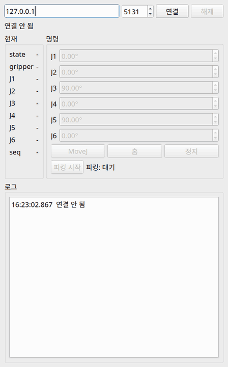
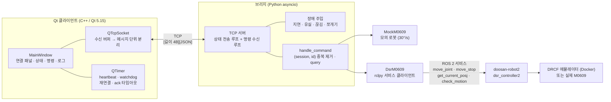
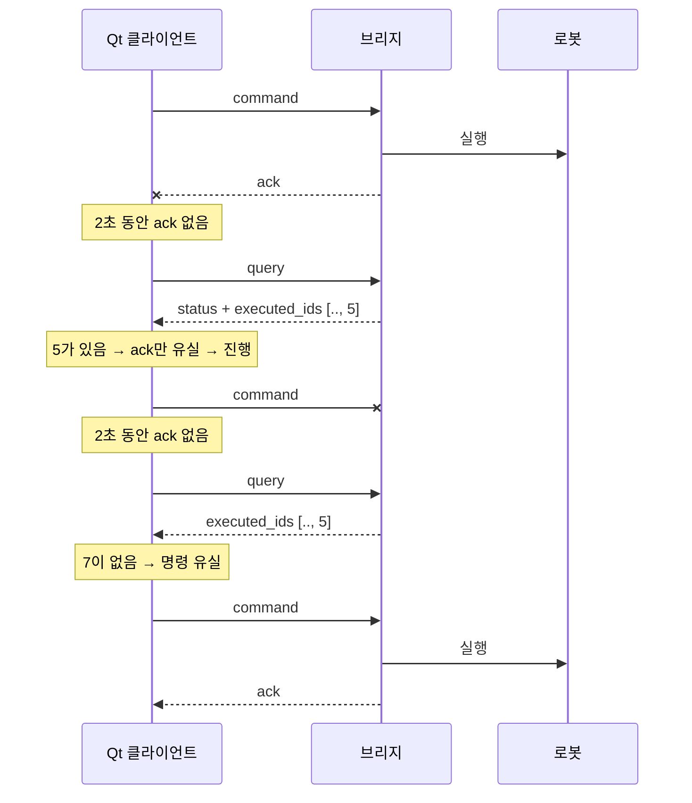

# Qt TCP 로봇 제어 클라이언트 (M0609)

Qt Widgets로 만든 **협동로봇(Doosan M0609) 제어 클라이언트**와, TCP로 이를 연결하는 **Python 브리지**입니다.
관절 이동(MoveJ)·홈·정지 명령, 실시간 상태 표시, 10단계 피스피킹 시퀀스를 지원하고,
**지연·유실·끊김이 있는 네트워크에서도 명령을 빠뜨리거나 두 번 실행하지 않도록** 설계했습니다.

같은 프로토콜로 두 가지 브리지에 붙습니다.

- `bridge/mock_m0609.py` — 로봇 없이 개발·테스트하는 **모의 로봇** (장애 주입 기능 포함)
- `bridge/dsr_bridge.py` — **doosan-robot2(ROS 2)** 를 통해 실제 컨트롤러/에뮬레이터를 구동

## 시연

모의 브리지에 **메시지 유실 25%** 를 걸고 피스피킹을 실행한 화면입니다(2배속).
로그에서 `⚠ 응답 없음 → query(실제 상태 재조회) → ✔ 실행됨 확인 / ✘ 미실행 → 같은 id로 재전송` 흐름을 볼 수 있습니다.



## 주요 기능

| 기능 | 설명 |
|---|---|
| 연결 관리 | 호스트/포트 입력, 연결·해제, 상태 표시, 오류 로그 |
| 상태 표시 | 로봇 state(IDLE/MOVING), 그리퍼, 관절 J1~J6, 메시지 번호(seq) |
| 명령 | MoveJ(목표 관절각), 홈, 정지, 그리퍼 |
| 피스피킹 | 열기 → 접근 → 하강 → 집기 → 상승 → 이동 → 하강 → 놓기 → 상승 → 홈 (10단계 자동) |
| 하트비트 | 클라이언트 1초마다 heartbeat, 양쪽 모두 3초 무수신 시 죽은 연결로 판단 |
| 자동 재연결 | 끊기면 1 → 2 → 4 → 8초(최대) 간격으로 재시도 (지수 백오프) |
| 버튼 잠금 | 이동 명령은 연결됨 + IDLE + 결과 대기 명령 없음일 때만. **정지는 항상 가능** |
| 실제 상태 재조회 | ack가 안 오면 바로 재전송하지 않고 `query`로 실행 여부를 확인 |
| 장애 주입 | 브리지 옵션으로 지연·유실·강제 끊김·메시지 쪼개짐을 만들어 복구 동작을 검증 |
| 로그 패널 | 연결 상태, 오류, 보낸 명령(→), 받은 응답(←), 복구 판단(⚠ ✔ ✘ ↻) |

## 구조



브리지는 `movej / home / stop / grip / status` 함수만 가진 **로봇 객체**를 받아 TCP 서버를 엽니다.
모의 로봇과 doosan-robot2 로봇이 같은 함수를 가지고 있어서, **Qt 코드는 한 줄도 바꾸지 않고** 둘을 바꿔 끼울 수 있습니다.

### ack가 유실됐을 때의 복구

"명령이 사라진 것"과 "ack만 사라진 것"은 클라이언트 입장에서 구분할 수 없습니다.
무작정 다시 보내면 두 번 실행될 수 있으므로, **실제 상태를 먼저 물어봅니다.**



- 재전송은 **같은 id**로 합니다. 앞의 것이 늦게라도 실행됐다면 브리지가 중복으로 보고 실행하지 않습니다(멱등성).
- `query`는 읽기만 하므로 여러 번 보내도 안전합니다. 3번 더 물어봐도 답이 없으면 **추측하지 않고 피킹을 중단**합니다.
- 재연결 직후에도, 결과를 모르는 명령이 있으면 `query`부터 보내 상태를 맞춥니다.

## 프로토콜

양방향 모두 같은 프레임을 씁니다.

```
┌────────────────────────┬──────────────────────────┐
│ 길이 (uint32, 빅엔디언)  │ 본문 (UTF-8 JSON, 길이만큼) │
└────────────────────────┴──────────────────────────┘
```

TCP는 바이트 스트림이라 메시지 경계가 없습니다. 메시지가 쪼개져 오거나 여러 개가 붙어 올 수 있어서,
수신 측은 바이트를 버퍼에 모은 뒤 **길이만큼 다 모였을 때만** 메시지 하나를 꺼냅니다(`MainWindow::onReadyRead`).
길이가 1MB를 넘으면 데이터가 어긋난 것으로 보고 연결을 끊습니다.

| 방향 | type | 주요 필드 |
|---|---|---|
| 브리지 → Qt | `status` | `state`(IDLE/MOVING/UNKNOWN), `joints`[6], `gripper`, `seq` |
| 브리지 → Qt | `ack` | `id`, `cmd`, `ok`, `error`, `duplicate` / query면 `status`, `executed_ids` |
| Qt → 브리지 | `command` | `session`, `id`, `cmd`(movej/home/stop/grip/query), `joints`, `close` |
| Qt → 브리지 | `heartbeat` | (없음) |

- `seq`는 연결마다 0부터 1씩 증가합니다. 건너뛰면 status 유실을 알 수 있습니다.
- `session`은 Qt 앱이 켜질 때 만드는 UUID입니다. 앱을 다시 켜면 id가 1부터 다시 시작하므로, 브리지가 이전 실행의 id와 섞지 않게 합니다.

자세한 형식은 [`bridge/mock_m0609.py`](bridge/mock_m0609.py) 맨 위 설명에 있습니다.

## 실행 방법

### 요구 사항
- Ubuntu 24.04, CMake 3.16+, C++17, **Qt 5.15** (`qtbase5-dev`)
- Python 3.12 (모의 브리지는 표준 라이브러리만 사용)
- (doosan-robot2 연결 시) ROS 2 Jazzy, [doosan-robot2](https://github.com/doosan-robotics/doosan-robot2) jazzy 브랜치, Docker

### 1. 모의 로봇으로 실행
```bash
# 빌드
cmake -S . -B build
cmake --build build

# 터미널 1: 모의 브리지
python3 bridge/mock_m0609.py

# 터미널 2: Qt 앱 → [연결] → [피킹 시작]
./build/qt_and_tcp
```

### 2. 장애를 걸고 실행
```bash
python3 bridge/mock_m0609.py --delay 0.2 --loss 0.2 --cut-rate 0.05 --seed 1
```

| 옵션 | 의미 |
|---|---|
| `--delay 0.2` | 브리지가 보내는 모든 메시지를 0.2초 늦게 보냄 |
| `--loss 0.2` | 메시지(양방향)를 20% 확률로 버림 |
| `--cut-rate 0.05` | 1초마다 5% 확률로 연결을 강제로 끊음 |
| `--seed 1` | 무작위 값 고정 (타이밍에 따라 완전히 같지는 않음) |
| `--split` | 메시지를 반으로 잘라 0.2초 간격으로 보냄. 그 사이 보낼 메시지는 뒷부분에 붙여 보냄 (쪼개짐·붙음 재현) |
| `--client-timeout 3` | 클라이언트가 3초 동안 조용하면 끊음 (0 = 끄기) |

### 3. doosan-robot2 virtual 모드(에뮬레이터)로 실행
```bash
# 터미널 1: 컨트롤러 + 에뮬레이터 (에뮬레이터 컨테이너는 launch가 자동으로 켜고 끔)
source ~/ros/install/setup.bash
ros2 launch dsr_bringup2 dsr_bringup2_rviz.launch.py \
    mode:=virtual host:=127.0.0.1 port:=12345 model:=m0609 gui:=true

# 터미널 2: doosan-robot2 브리지 (장애 옵션도 그대로 사용 가능)
source ~/ros/install/setup.bash
python3 bridge/dsr_bridge.py

# 터미널 3
./build/qt_and_tcp
```

| 우리 명령 | doosan-robot2 서비스 (`/dsr01/dsr_controller2/...`) |
|---|---|
| movej, home | `motion/move_joint` (`sync_type=1`, 비동기) |
| stop | `motion/move_stop` (`DR_QSTOP`) |
| status | `aux_control/get_current_posj` + `motion/check_motion` 0.1초 폴링 |
| grip | virtual 모드에는 그리퍼가 없어 브리지 내부 상태로 흉내 |

관절 범위는 `dsr_description2`의 M0609 URDF 값(J3 ±150°, 나머지 ±360°)으로 검사합니다.

## 검증 결과

피스피킹 10단계를 장애 조건별로 실행하고, **브리지 로그 기준으로 실제 실행된 명령**을 분석했습니다.

| 대상 | 장애 | 결과 |
|---|---|---|
| 모의 로봇 | 없음 | 완료 14.6초, 10단계 순서대로 1회씩 |
| 모의 로봇 | 지연 0.4초 | 완료 18.5초 |
| 모의 로봇 | 유실 25% | 완료 26~39초, ack 유실·명령 유실 모두 복구 |
| 모의 로봇 | 끊김 15%/s | 3회 끊김·재연결 후 완료 |
| 에뮬레이터 | 없음 | 완료 19.6초 |
| 에뮬레이터 | 지연 0.2 + 유실 15% + 끊김 5%/s | 완료 24.4초 |
| 모의/에뮬레이터 | 유실 20% 이상 | 드물게 query가 4회 연속 유실 → **설계대로 안전 중단** (중복·누락 실행 없음) |

그 밖에 수신 측 프레이밍은 **1바이트씩 쪼개 보내기 / 여러 메시지를 한 번에 보내기 / 비정상 길이 헤더**를 보내는 테스트 서버로 따로 검증했습니다.

## 개발하며 겪은 문제와 해결

| 문제 | 원인 | 해결 |
|---|---|---|
| 연결된 채로 창을 닫으면 크래시 | 자식 객체는 만든 순서대로 삭제됨 → 라벨이 먼저 지워지고, 마지막에 지워지는 소켓이 `stateChanged`를 보내 삭제된 라벨에 접근 | 소멸자에서 소켓 시그널을 먼저 끊음 |
| 같은 서버에 붙은 두 클라이언트의 seq가 1, 3, 5 / 2, 4, 6으로 건너뜀 | 모든 연결이 공유하는 로봇 객체에 카운터를 둠 | 카운터를 연결마다 실행되는 함수의 지역 변수로 이동 |
| 서버가 먼저 끊으면 오류 문장이 바로 사라짐 | 상황에 따라 `errorOccurred`와 `stateChanged`의 순서가 다름 → 라벨 덮어쓰기 | 지워지지 않는 로그 패널에 모두 기록 |
| ack가 안 오면 재전송해야 할지 알 수 없음 | 명령 유실과 ack 유실을 클라이언트가 구분할 수 없음 | `query`로 실제 실행 여부 확인 + 같은 id 재전송 + 브리지 중복 제거 |
| 피킹이 로봇 도착 전에 다음 단계로 넘어갈 위험 | ack 직후에 도착하는 status는 명령 **이전** 상태일 수 있음 | 확정 시 "MOVING"으로 가정, 에뮬레이터 브리지는 명령 직후 0.3초간 IDLE 무시 |
| 앱을 다시 켜면 명령이 실행되지 않는데 OK 응답 | id가 1부터 다시 시작 → 브리지가 이전 실행 기록과 같은 id를 "중복"으로 판단 | 앱 실행마다 UUID 세션 id를 붙이고 `(session, id)`로 중복 판단 |
| doosan 브리지가 Ctrl+C로 안 꺼짐 | `rclpy.init()`이 SIGINT/SIGTERM을 가로채 ROS만 멈추고 asyncio 서버는 계속 동작 | rclpy 신호 처리 끄기(`SignalHandlerOptions.NO`) |
| doosan 브리지 상태가 가끔 계속 UNKNOWN | 서비스 디스커버리 전에 보낸 첫 요청이 사라지고, 그 응답을 영원히 기다림 | 서비스 연결 전에는 묻지 않고, 1초 넘게 답이 없으면 버리고 다시 질문 |

## 디렉터리 구조

```
.
├── CMakeLists.txt          # Qt5 Widgets + Network, AUTOMOC
├── main.cpp                # QApplication + MainWindow
├── mainwindow.h / .cpp     # UI, 소켓, 프레이밍, 타이머, 복구 로직, 피킹 시퀀스
├── bridge/
│   ├── mock_m0609.py       # TCP 서버 + 장애 주입 + 모의 로봇
│   └── dsr_bridge.py       # 같은 서버 + doosan-robot2 ROS 2 서비스 로봇
└── docs/
    ├── demo.gif
    └── screenshot.png
```

## 한계와 다음 단계

- 클라이언트는 한 번에 하나의 이동 명령만 보냅니다(정지 제외). 여러 명령을 미리 보내는 파이프라인은 지원하지 않습니다.
- 브리지는 클라이언트 여러 개의 접속을 받지만, 로봇은 하나라서 명령이 섞일 수 있습니다. 실제로는 제어권을 가진 클라이언트 하나만 허용해야 합니다.
- 장애 주입의 `--seed`는 메시지 타이밍에 따라 결과가 조금씩 달라집니다. 완전한 재현에는 "N번째 메시지 유실" 같은 시나리오 방식이 필요합니다.
- 그리퍼는 virtual 모드에서 흉내만 냅니다. 실제 장비에서는 `io/set_tool_digital_output` 등으로 연결해야 합니다.
- 창 제목이 아직 처음 정한 "TCP Chat"입니다.

## 배운 점

<!--
TODO(직접 쓰기): 면접에서 말할 내용이라 본인 말로 써야 의미가 있습니다. 아래 질문에 3~5줄씩 답해 보세요.
  1. 이 프로젝트에서 가장 어려웠던 문제 하나는? 처음에 어떻게 생각했고, 무엇을 보고 원인을 알았나요?
  2. "보냈다 ≠ 실행됐다"를 겪기 전과 후에, 네트워크 프로그램을 보는 관점이 어떻게 달라졌나요?
  3. Qt의 시그널/슬롯과 이벤트 루프를 처음 배울 때 헷갈렸던 점과, 지금은 어떻게 이해하고 있나요?
  4. (선택) 지역 변수 / 멤버 변수 / 공유 객체 중 어디에 값을 두느냐로 생긴 버그를 몇 번 겪었나요?
-->
